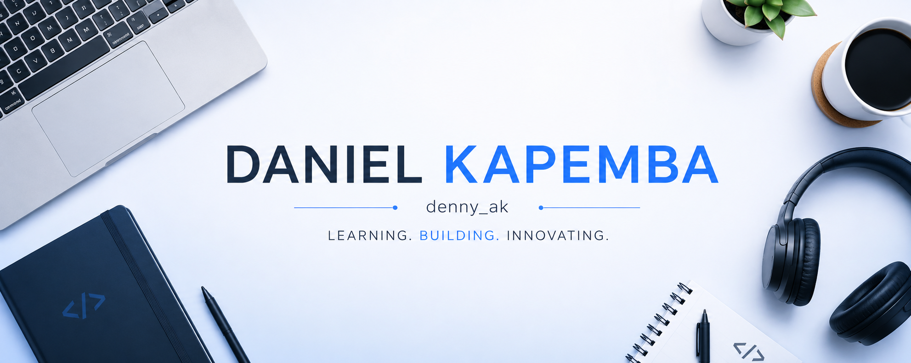
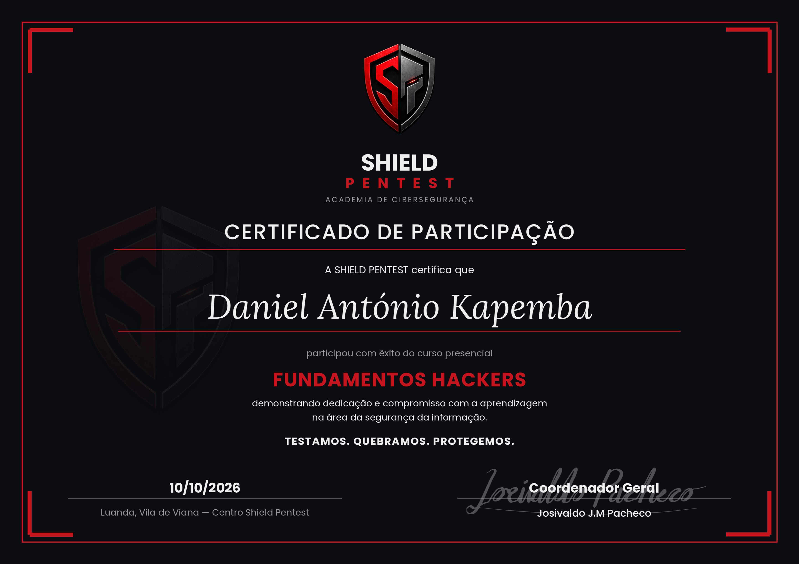
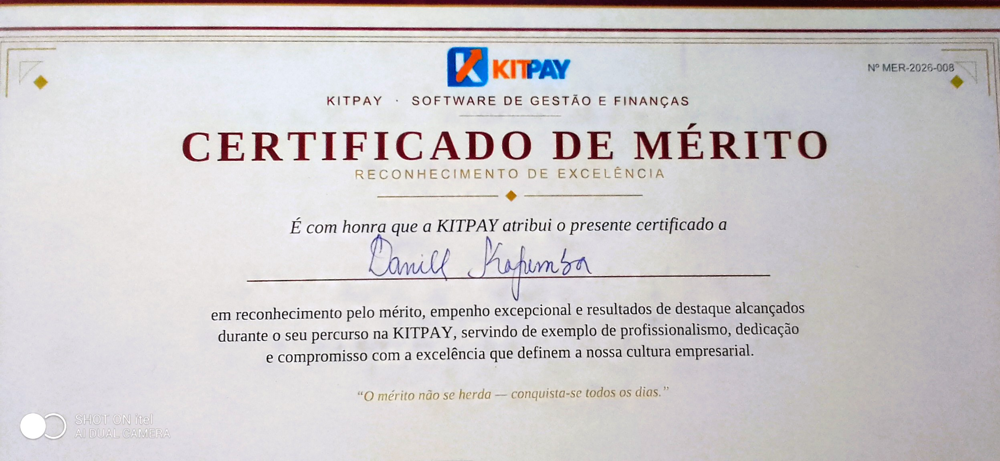

<div align="center">

# 👋 Hi, I'm Daniel António Kapemba
Conhecido por Denny AK

### Backend & Database Developer in evolution · Cybersecurity Enthusiast



**Learning. Building. Innovating.**

<br>

\

</div>

---

## 👨‍💻 About Me

I'm **Daniel António Kapemba**, a software developer from **Angola**, building my career around **Backend Development, Databases and Cybersecurity**.

I'm particularly interested in what happens behind the interface — how applications process requests, how data is structured and stored, how systems communicate, and how vulnerabilities can compromise them.

My professional path is built around:

```text
Backend
   ↓
Databases
   ↓
Systems & Networks
   ↓
Cybersecurity
```

I learn primarily by **building real projects, experimenting in laboratories and solving practical problems**.

My goal is not  to know many technologies.

> **I want to understand how systems are built, how data is handled, and how everything can be protected.**

---

## 🧭 My Current Focus

<table>
<tr>
<td width="50%">

### 💻 Backend

* PHP
* Laravel
* JavaScript
* C#

</td>

<td width="50%">

### 🗄️ Databases

* SQL
* MySQL
* Database Design
* Data Modeling
* Database Security

</td>
</tr>

<tr>
<td width="50%">

### 🐧 Operating Systems

* Ubuntu
* Kali Linux
* Windows

</td>

<td width="50%">

### 🛡️ Cybersecurity

* Security Fundamentals
* Ethical Hacking
* Secure Development
* Pentest

</td>
</tr>
</table>

---

#  Certifications


<p>Uma certificação que demonstra o meu compromisso em aprender e evoluir na área de segurança cibernética.</p>


<p>Certificação de mérito em estágio, demonstrando o meu avanço e crescimento constante em desenvolvimento, lógica de programaçao e resolução de problemas reais.</p>
---

# 🛠️ Tech Stack

### Languages

<p align="left">

<a href="https://www.php.net/">

</a>

<a href="https://www.javascript.com/">

</a>

<a href="https://laravel.com/">

</a>

<a href="https://www.net.com">
   
</a>

</p>

### Databases

<p align="left">

<a href="https://www.mysql.com/">

</a>

<a href="https://www.w3schools.com/sql/">

</a>

</p>

### Systems & Tools

<p align="left">

<a href="https://ubuntu.com/">

</a>

<a href="https://git-scm.com/">

</a>

<a href="https://github.com/">

</a>

<a href="https://code.visualstudio.com/">

</a>

</p>

---

# 🚀 Featured Projects

### 🔐 DocSign

**Digital Signature & Document Management System**

A project focused on secure document management, authentication, access control and digital signatures.

**Focus:**

`PHP` `MySQL` `Security` `Authentication` `RBAC` `Cryptography`

> Repositório Disponível Em Breve

---

### 🤖 Denny-ChatBot

A chatbot developed during an internship that processes user questions, searches for matching answers stored in a `.JSON` file and, when necessary, retrieves information from the Web.

**Focus:**

`JavaScript` `JSON` `Web` `Logic`

> Repositório Disponível Em Breve

---

### 💼 Portfolio

My personal portfolio showcasing my projects, technical journey and professional development.

> Repositório Disponível Em Breve

---

# 🧠 How I Learn

I don't want to learn technology only by memorizing commands.

My learning cycle is:

```text
        LEARN
          ↓
       BUILD
          ↓
      BREAK IT
          ↓
     UNDERSTAND
          ↓
       SECURE
          ↓
       IMPROVE
          ↓
        REPEAT
```

Every project is an opportunity to understand something deeper.

---

# 🧭 My Roadmap

### 01 — Backend & Databases

`Backend Development` → `SQL` → `Database Engineering` → `APIs`

⬇️

### 02 — Systems & Networking

`Linux` → `Operating Systems` → `Networking`

⬇️

### 03 — Cybersecurity

`Security Fundamentals` → `Web Security` → `Ethical Hacking` → `Security Engineering`


⬇️

---

# 📚 Currently Learning

```text
Backend Development
SQL & Database Engineering
Linux
Networking
Ethical Hacking
Cybersecurity
```

### 🎯 Next Milestones

* [ ] Strengthen Backend Development
* [ ] Deepen SQL & Database Engineering
* [ ] Complete Networking foundations
* [ ] Prepare for data center & cloud security
* [ ] Strengthen Linux & Systems
* [ ] Continue Ethical Hacking
* [ ] Build security-focused projects

---

---

# 🔥 Contribution Streak

<div align="center">


</div>

---

# 📈 Contribution Activity

<div align="center">


</div>

---

# 🌍 Beyond Code

I'm also working on:

* 🇬🇧 Improving my English
* 🧠 Developing problem-solving skills
* 📚 Studying technology consistently
* 🌐 Building a professional network
* 🚀 Participating in technology projects
* 🤝 Exploring Open Source

---

# 🤝 Let's Connect

I'm interested in connecting with:

* Backend Developers
* Database Professionals
* Cybersecurity Professionals
* Students and technology enthusiasts
* Open Source contributors
* People building interesting things

<div align="center">

### **Let's learn, build and innovate together.**

<br>

**Learning. Building. Innovating.**

🇦🇴 **Angola**

</div>
